# 本体视频法：对象、关系、数值与锁定图路线

> 版本 v0.4 · 2026-09-30 · 麦秋选 · 图文版 · C 线工作流已在 Visual Studio 内实现并跑通 E2E

> 📌 **背景**
> 售后技术支持已有三处明确需求指向"用数模/动画做作业指导与培训内容"（BRD 第 10 条、9/11 技术支持日会、9/20 门店场景纪要），但都卡在"3D 数模来源"。与此同时，M9 / ES8 本体建设已经沉淀了对象、链接、证据片段、复核状态这套框架。本方案把两件事接起来：**用已有的本体框架驱动视频生成，用锁定图片绕开数模来源问题。**

> 🎯 **目标**
> 1. 说清"本体已建模、AI 只填数值"在本体框架里的准确含义。
> 2. 说清本体之间的联系和数值在视频里各自怎么体现。
> 3. 给出一条不建 3D 模型也能保证画面可信的路线，并给出两周内可验证的最小 Demo。

---

## 一、结论先行

| 判断 | 结论 |
|---|---|
| "本体已建模，AI 只填数值"能不能成立 | **成立。** SU7 服务车库 V2.3 已跑通同一模式：AI 只输出受控 patch，前端按能力表校验，未知 ID 原子拒绝，无 AI 时手动照常用。 |
| "填数值"填什么 | **填有界枚举和比例，不填裸浮点。** 相机坐标、位移这类连续值由程序算，或直接被锚图替代。 |
| 本体之间的联系怎么进画面 | 链接不需要新对象类型，**一条链接被渲染成三种画面语法之一：同框、先后、脚注**。 |
| 要不要先建 3D 白模 | **不必。** 把图片当属性值锁死（锚图），视频只做锚图之间的短补间；维修指导线也够用，需要绕零件自由转的镜头以后单独补 3D。 |

---

## 二、需求从哪来，往哪去

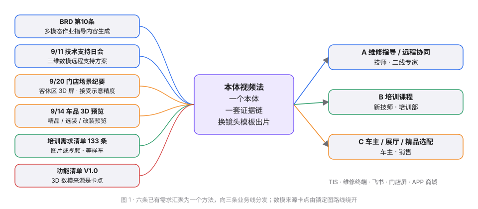

| 来源 | 要点 | 与本方案的关系 |
|---|---|---|
| 《48篇BRD-6.1核心业务需求汇编》第 10 条 | 基于维修方案与数模，AI 自动生成图解步骤、动图/短视频脚本、3D 演示与语音伴随脚本，输出至 TIS 与维修终端 | BRD 落点 |
| 技术支持日会纪要 2026-09-11 | 三维数模远程支持方案：动画展示拆装步骤；建议优先 ADAS 诊断场景 | 团队已认可方向 |
| 服务策略与门店场景纪要 2026-09-20 | 客休区 3D 屏展示维修进度与部件拆解，"无需过度追求细节精度" | 明确接受示意精度 |
| 《维修技术支持 AI 功能清单（含眼镜）V1.0 补充稿》 | 远程协同要推送 3D 拆装演示；依赖项写明"3D 数模来源需先解决" | 公认卡点，锁定图路线绕开 |
| 车品 3D 预览方案讨论 2026-09-14 | 精品 / 选装 / 改装的网页 3D 预览 | 第二条业务线：营销选配 |
| 技术课程开发需求清单（133 条技术类） | 大量"图片或视频""整车数模图"标"部分提供"，等样车 | 第三条业务线：培训，可在样车前先出片 |
| 《技术支持AI案例库》C-20260908-01 | 视频转写生成结构化 SOP（步骤 / 要点 / 警示 / 责任人） | SOP 结构就是视频脚本的输入结构 |
| 《M9本体搭建六步法对照》《知识工程与本体》、doc-to-ontology skill | 规则 / 资料底本 / 证据片段 / 场景快照 / 判定 / 复核事项 | 视频本体直接复用这套治理字段 |

飞书内搜索"白模""Blender"均无业务文档：这是新概念，需要用 Demo 讲清。

---

## 三、方法框架：四层结构

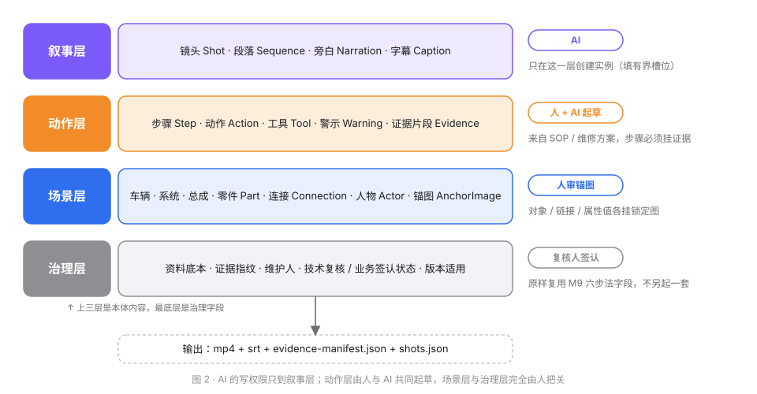

按团队已在用的本体框架理解（对象类型 → 属性 → 链接类型 → 动作，外加事实来源与复核状态治理字段），视频不引入新范式：只在场景层增加"锚图"这一种属性类型，在叙事层增加 Shot / Narration 两类对象。

- **叙事层**：AI 唯一有写权限的层。它做的事只有一件——创建 Shot 实例。
- **动作层**：来自 SOP / 维修方案。每个 Step 必须挂 Evidence，否则该步骤的旁白不发声。
- **场景层**：对象、链接、属性取值都可以钉一张锁定图。
- **治理层**：资料底本、证据指纹、维护人、双复核状态、版本适用——原样复用 M9 六步法字段。

---

## 四、详细设计

### 4.1 对象与链接

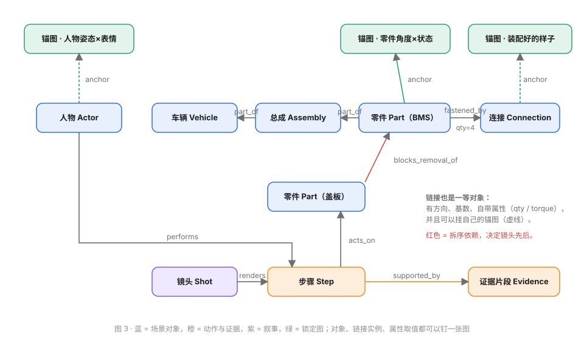

`Shot` 相当于 M9 方法里的"场景快照"实例；一次出片相当于一次"判定运行"；每个镜头链接到它引用的证据片段。链接是一等对象：有方向、有基数、自带属性（`qty`、`torque`），并且链接实例本身也可以挂锚图。

### 4.2 数值：属性分三档

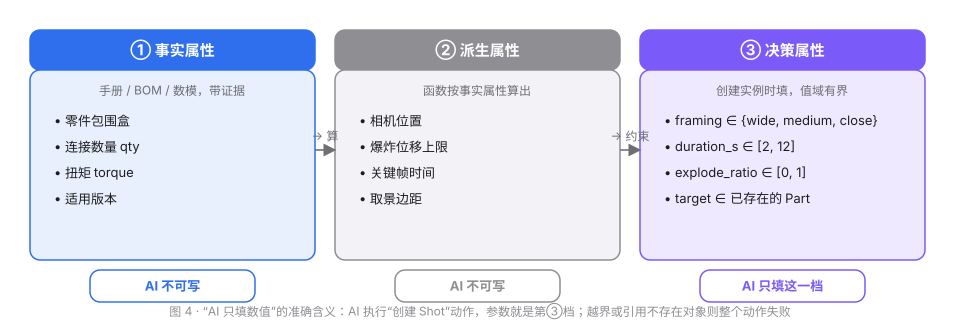

"AI 只填数值"精确地说是：**AI 执行"创建 Shot"这个动作，动作参数就是第③档决策属性，值域校验由本体平台做，越界或引用不存在的对象就整个动作失败**。这与框架里 Action 带参数、带校验规则、带副作用的定义完全一致。

### 4.3 联系：链接的三种画面投影

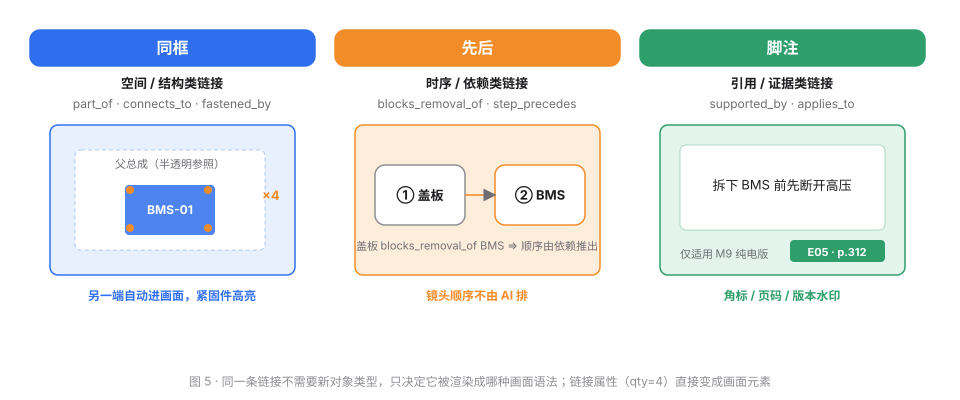

链接自带的属性直接变成画面元素：`fastened_by` 上的 `qty=4` 就是画面里的 "×4" 标注；`torque` 有值就出现，为空就不出现——不编。

### 4.4 一个镜头串起来

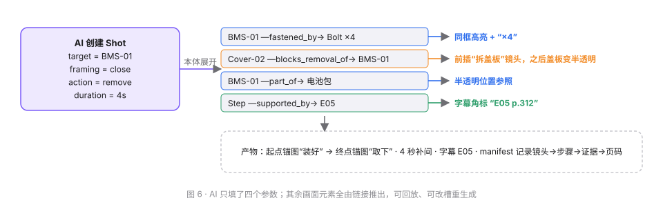

---

## 五、渲染路线：为什么选"锁定图本体"

### 5.1 三条路线比较

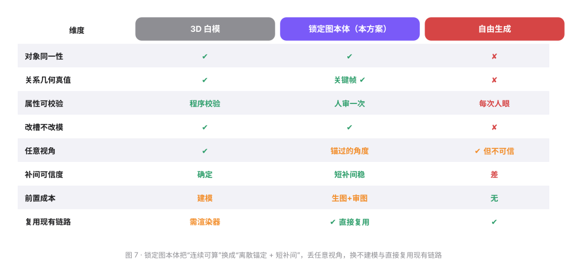

自由生成保得住内容层（出场对象、顺序、旁白证据），保不住对象同一性和关系几何真值，对维修指导线不够。3D 白模全都保得住，但要先建模，而数模来源本身就是卡点。**锁定图本体是中间解：把"连续可算"换成"离散锚定 + 短补间"。**

### 5.2 锁定图本体的定义

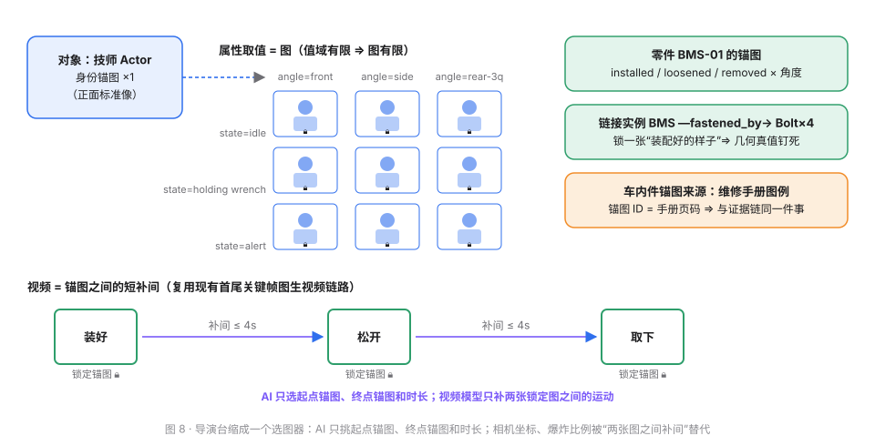

- **对象 = 身份锚图**：一个人 / 一个 BMS 有一张标准像。
- **属性取值 = 图**：`angle`、`state`、`expression`、`holding` 每个枚举值挂一张锁定图；值域有限，图就有限。
- **链接实例 = 图**：`BMS —fastened_by→ Bolt×4` 也锁一张"装配好的样子"，几何真值被钉死。
- **动作 = 选图**：AI 只挑起点锚图、终点锚图、时长。

这与现有 `/api/v1/image-videos` 首尾关键帧图生视频链路是一回事：首帧 = 锁定的"装好"图，末帧 = 锁定的"拆下"图，视频模型只负责中间几秒的运动。导演台缩成一个选图器。

### 5.3 关键帧密度决定可信度

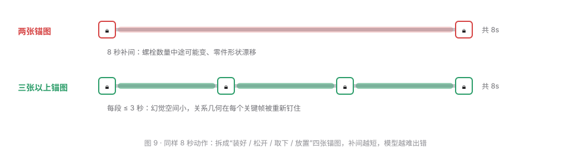

### 5.4 锚图从哪来、谁审

| 对象类别 | 锚图来源 | 难度 |
|---|---|---|
| 人物、外观件、精品配件 | 生图 + 多参考图编辑 → 人审一次 → 锁定 | 低 |
| 车内件 | **维修手册图例本身就是现成锚图**：直接作锁定图或作生图参考；锚图 ID 与手册页码是同一件事 | 中，比 3D 更贴证据链 |
| 组合状态（链接实例） | 手册分解图 / 装配图 | 中 |

组合数要控：不给全部零件建锚图，只给当前 SOP 用到的件建，按需扩。生成不贵，**审图是瓶颈**，审过的图必须进本体永久复用。

---

## 六、三条业务线共用一个本体

| 线 | 观众 | 镜头模板差异 | 锁定图路线能否达到 |
|---|---|---|---|
| A 维修指导 / 远程协同 | 技师、二线专家 | 近景多、透视上下文、拆序严格、工具出镜、警示前置 | 够用，前提是关键帧密度够 |
| B 培训课程 | 新技师、培训部 | 先整车定位再局部、系统组成图、术语字幕、可分章 | 概念片与系统总览完全可以；部件级拆装同 A |
| C 车主 / 展厅 / 精品选配 | 车主、销售 | 慢旋转、爆炸炫技、精品试装同机位对比、不出工具不出警示 | 完全达到 |

同一套 Part / Connection / 锚图数据，只换镜头模板与旁白风格。

---

## 七、一次出片的流程与门禁

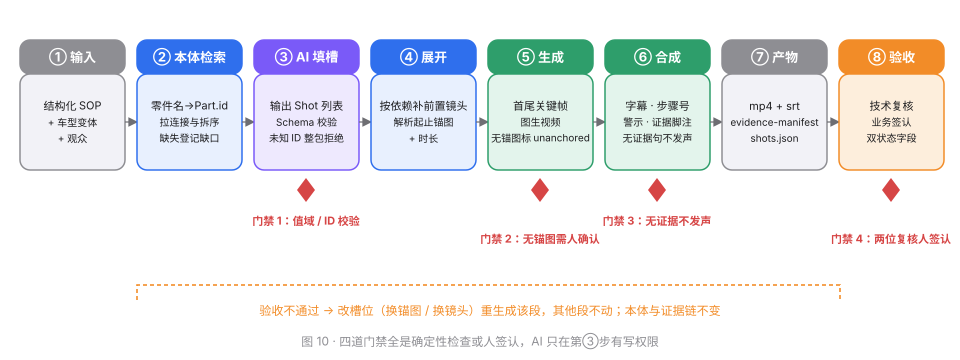

四道门禁全是确定性检查或人签认，AI 只在第③步有写权限。验收不通过时改槽位（换锚图 / 换镜头）重生成该段，其他段不动，本体与证据链不变。

### 分工（RASI）

| 事项 | 麦秋选 | 技术复核人 | 业务签认人 | 培训部 / 业务方 |
|---|---|---|---|---|
| 本体对象与链接建模 | R | S | I | I |
| 锚图生成与入库 | R | A（部件、顺序） | I | S（提供手册图例） |
| Shot 槽位设计与 AI 接入 | R | S | I | I |
| 旁白口径与证据核对 | S | S | A | I |
| 镜头模板（三条线） | R | I | S | S |
| 视频验收 | S | A | A | I |

R 负责 · A 批准 · S 支持 · I 被通知

---

## 八、分阶段路线

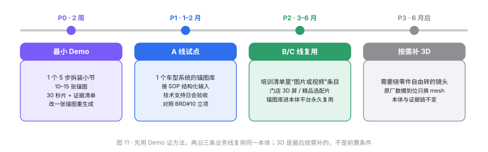

**P0 最小 Demo（2 周）**：一个 5 步以内的拆装小节（M9 / ES8 手册有现成图例，或 SU7 车库已验证的 BMS 拆卸路线）；每步 2–3 张锚图，共 10–15 张；产出 30 秒视频 + SRT + 证据清单；同一 `shots.json` 人工换一张锚图重生成一段，证明"改槽不改模"。在技术支持日会上对照 BRD 第 10 条与功能清单待决第 5 项验收。

**不做**：TTS 声库选型、原厂数模接入、AR、C 端上线、3D 建模。

---

## 九、风险与对策

| 风险 | 对策 |
|---|---|
| 锚图是推定还是事实分不清 | 手册图例来源标 `evidence`，生图来源标 `simulated`，画面带"示意"水印 |
| AI 选错目标（同名件多配置） | 强制追问车型变体，不猜 |
| 补间过程幻觉 | 单镜头超过 6 秒强制拆成多段锚图 |
| 旁白幻觉 | 无证据不发声，只留灰字 |
| 图生视频配额 | 先在短 Demo 上验证密度与时长的关系再放量 |
| 合规 | 不含 VIN / 用户数据；培训与营销素材分库；外发走既有数据外发流程 |

---

## 十、需决策事项

| # | 决策 | 建议 |
|---|---|---|
| 1 | Demo 车型：SU7 还是 M9 / ES8 | M9 / ES8——手册图例可直接当锚图，业务对口 |
| 2 | 锚图的技术复核人与业务签认人 | 沿用 M9 方法现有两位负责人 |
| 3 | 输出容器：TIS 还是飞书 | 先飞书（培训部现在收资料靠飞书表格），TIS 待接口 |
| 4 | 是否把"3D 数模来源与远程可视化 PoC"从待决改为立项 | Demo 通过后在日会提请 |

---

## 十一、已实现：C 线工作流（Visual Studio · 2026-09-30）

> 🎯 **一句话**：在 `weiaidesign-visual-studio` 里加了一条「需求 → 本体 → 锚图 → 人审 HTML → 首尾锚图补间出片」的链路，全部复用现有生图 / 图生视频接口，没有新依赖。

### 11.1 入口与接口

| 入口 | 说明 |
|---|---|
| 页面 `/ontology` | 写需求、选受众线（展厅 / 精品选配 / 车主）与画幅，一键起草本体并开始出锚图；列出最近本体 |
| `POST /api/v1/ontology` | 需求 → LLM 起草本体 JSON（对象 / 属性枚举 / 链接 / 锚图计划 / 镜头），服务端规范化：未知 id、跨对象补间、重复起止对一律丢弃并记日志 |
| `POST /api/v1/ontology/{id}/anchors` | 后台逐张生成锚图：先 identity，再以 identity 为参考图做属性 / 链接锚图（多参考图编辑，保证同一性） |
| `GET /api/v1/ontology/{id}/review` | **人工审核 HTML**：对象与属性锚图卡片（通过 / 驳回 / 填意见重生成）、关系图与链接表、镜头起止锚图 + 可改字幕与运动提示、审核备注；后台任务中自动刷新 |
| `PATCH /api/v1/ontology/{id}` | 写入审核决定；全部镜头通过且两端锚图通过 → 状态 `approved` |
| `POST /api/v1/ontology/{id}/generate` | 已通过镜头 → 网关 `image-videos`（`first_image_b64 / last_image_b64 / video_prompt`，固定 8 秒）；`GET` 本体时自动同步视频状态与链接 |

存储在 `IMAGE_OUTPUT_DIR/_ontology/{id}.json`，锚图复用 `generated-images` 目录与公网 URL。可选环境变量 `ONTOLOGY_MAX_ANCHORS`（默认 14）、`ONTOLOGY_MAX_SHOTS`（默认 6）。

### 11.2 与方法的对应

| 方法里的概念 | 代码里的落点 |
|---|---|
| 对象 / 属性取值 / 链接实例各挂一张锁定图 | `Anchor.kind = identity \| attribute \| link`，链接锚图的参考图同时带上两端对象的 identity 图 |
| AI 只填有界槽位 | LLM 只能产出枚举值、锚图 id 引用、8 秒镜头；相机坐标不存在，坐标被"两张图之间补间"替代 |
| 门禁 1：值域 / ID 校验 | `normalizeDraft()`：引用不存在的锚图、跨对象补间、重复起止对整条丢弃 |
| 门禁 2：无锚图需人确认 | 审核页里未生成 / 失败的锚图不能点「通过」，镜头两端不通过则 `generate` 不提交 |
| 门禁 3：字幕来源 | 每条字幕标 `brief`（来自需求原文）或 `ai`（AI 补写），审核页可直接改 |
| 改槽不改模 | 驳回单张锚图并重生成，其他锚图、镜头、本体不动；单个镜头可单独重新提交 |

### 11.3 本地 E2E 证据（2026-09-30）

需求：「深空灰 SU7 停在夜间展厅，先绕车半圈，再车顶装原厂行李架，同机位对比装前装后」。

- 起草 8.8 秒（回退到 gpt-5.4-mini，见 11.4），3 对象 / 1–2 链接 / 4–6 锚图 / 2 镜头；改进提示词后主体自动获得 `view-angle` 属性（前 45° / 后 45°），「绕车」镜头不再被丢。
- 4 张锚图全部 gpt-image-2 生成；链接锚图「装架后」以 SU7 identity 图为参考编辑，同车、同展厅、同机位，只多了车顶行李架。
- 审核 → 生成：镜头 `shot-02` 提交网关 3.6 秒返回 job；约 6 分钟后完成，`dreamina-seedance-2-0`，1280×720 / 8.08 秒 / 2.6 MB，已归档 Drive。

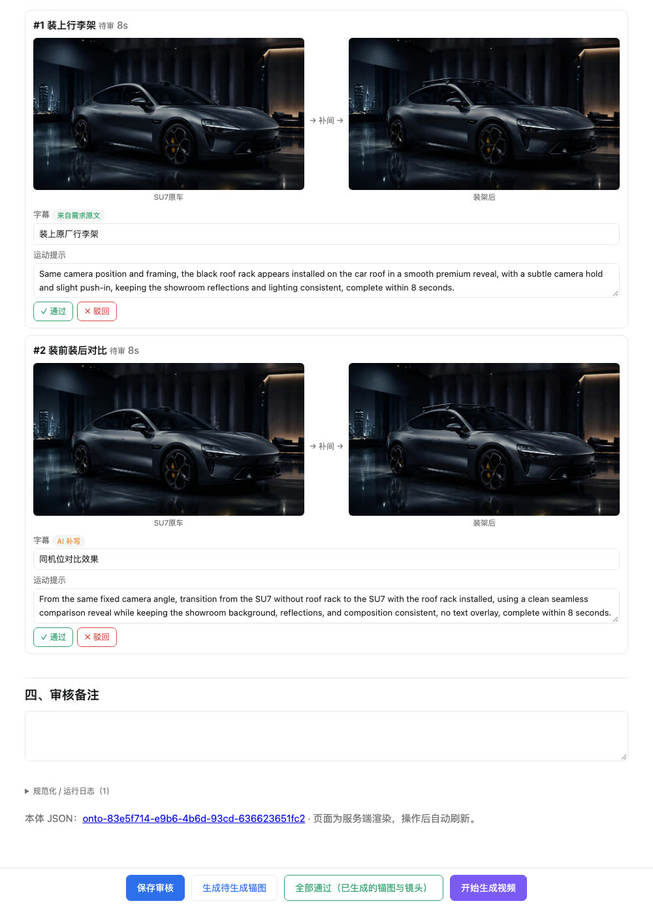

### 11.5 三种路线同题对比（2026-09-30，生产环境）

同一需求「深空灰 SU7 夜间展厅，同机位对比原车 / 装运动尾翼」、同一网关与运动提示，只换关键帧来源：① 自由生成（只给提示词）② 锚图本体（生产 `/api/v1/ontology`，claude-sonnet-5 起草，5 张锚图）③ 3D 白模重绘（SU7 车库 Three.js 同机位截两帧 → GPT-image 参考重绘 → 补间）。对比页（含三段成片与并排视频）：<https://yundongyl.cn/ontology-video/compare/>。

- ① 车不是 SU7，首尾两帧是两台不同的车——自由生成保不住对象同一性的实证。
- ② 与 ③ 都保住同一性、画质相当；③ 几何来自 GLB 是真的，② 是参考编辑"像"出来的但不需要 3D 资产且人可逐张把关。两者可合并：车库截图当锚图喂进本体。
- 三路共同问题：Seedance 把 "subtle push-in" 做成大幅推近，机位没锁住；下一步用 "locked-off static camera" 措辞复测。
- 暴露的产品缺口已修：审核页可换镜头起止锚图（PATCH 接受 `start_anchor / end_anchor`）；生产 `review_url` 曾指向容器内 origin，改用 `PUBLIC_BASE_URL`。
- 网关任务在内存：容器重建导致一次任务丢失（① 重提），需落盘。

### 11.4 已知问题与未做

1. **`AGENT_LLM_API_KEY` 在 router 上返回 401「无效的令牌」**（handoff env 版本），所有起草请求都静默回退到 relay 的 gpt-5.4-mini；本体质量可接受，但要用更强模型需先换 key。本体 JSON 的 `errors[0]` 会记录这次回退。
2. 审核页无鉴权（人直接打开），生产若开 `REQUIRE_ACCESS_TOKEN=1` 则页内按钮需带 token，尚未处理。
3. 未做：多镜头拼接成一条完整视频、字幕烧录、TTS；A / B 线（证据片段、手册图例作锚图）尚未接入。
4. ~~生产部署未执行~~ 2026-09-30 已按 `ops/windows/README-rebuild.md` 部署（WSL 源同步 → rsync 到 `C:\\Users\\qrrwi\\build\\weiaidesign-web` → 计划任务构建 → `up-web.ps1`），`weiaidesign.com/ontology` 与五个 API 均 200。生产 `AGENT_LLM_API_KEY` 有效（起草用 claude-sonnet-5），失效的只是 handoff env 副本。
